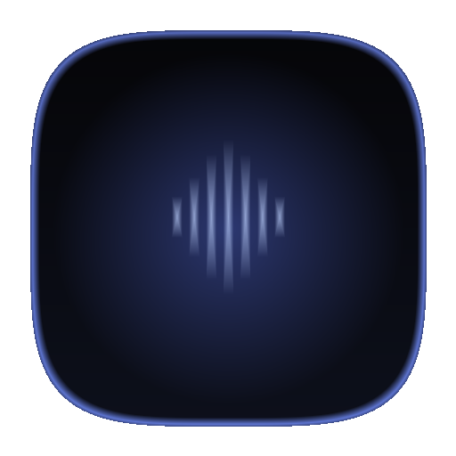

<div align="center">
  
  <h1>Meikai</h1>
  <p>
    A FOSS YouTube Music desktop client built with Tauri v2, Rust &amp; React featuring Rounded Glass UI,<br />
    custom dynamic backgrounds, LRCLIB synced lyrics, SponsorBlock, ReturnYouTubeDislike, and Last.fm.
  </p>

  <p>
    <a href="https://github.com/louisdevzz/meikai/releases"></a>
    <a href="https://github.com/louisdevzz/meikai/stargazers"></a>
    
    
    
    
  </p>
</div>

> **Warning**
> This app is currently in active beta development, so bugs or playback errors may occur. Because it depends on YouTube Music APIs and client stream extraction, upstream changes from YouTube can occasionally cause playback or parsing issues.

## Features

- **100% Live YouTube Music Data (No Login Required):** Browse Home Quick Picks, Featured Playlists, Top Charts, Music Videos, and live Moods & Genres directly via InnerTube & RustyPipe without needing an account.
- **Optional YouTube Music Sign-In:** Built-in WebView and cookie authentication to sync and load your personal YouTube Music playlists.
- **Glassmorphism & macOS Vibrancy UI:** Three-panel layout inspired by SimpMusic with native macOS overlay traffic lights, `HudWindow` vibrancy blur, Transparent Desktop mode, floating glass player bar, and Fullscreen Now Playing modal.
- **Lossless Custom Dynamic Backgrounds:** Set custom Video (`MP4`/`WebM`), animated `GIF`, or high-resolution static images stored locally via IndexedDB without image compression, complete with live blur and opacity controls.
- **Synced Lyrics (`LRCLIB`):** Real-time line-synced lyrics in the right side panel and fullscreen player with timing offset adjustments (`-0.5s` / `+0.5s`).
- **Audio Controls & Equalizer:** 10-band equalizer with curated presets (`Flat`, `Bass Boost`, `Anime & J-Rock`, `Vocal & Acoustic`, `Electronic / Phonk`, `Late Night`), playback speed control, and Sleep Timer.
- **Mix, Radio & Smart Search:** Generate endless YouTube Music radio queues (`next` endpoint), explore trending YouTube Charts artists, and search with live autocomplete & type filters (`Songs`, `Videos`, `Albums`, `Playlists`).
- **Your Library & On-Device Analytics:** Manage Favorites, Most Played, Local Playlists, playback history, and track listening statistics locally.
- **SponsorBlock, ReturnYouTubeDislike & Last.fm:** Auto-skip sponsor segments, view video vote stats, and scrobble tracks to Last.fm.
- **TikTok Audio Utility:** Extract and preview audio from TikTok links directly inside the desktop app.

## Data & Tech Stack

- **UI & Inspiration:** Inspired by [SimpMusic](https://github.com/maxrave-dev/SimpMusic) for desktop layout, theming, and feature design.
- **YouTube Music Extraction:** Powered by [RustyPipe](https://github.com/Theta-Dev/rustypipe) and YouTube Music InnerTube APIs in Rust.
- **Lyrics:** Provided by [LRCLIB](https://lrclib.net/).
- **Skip Segments & Stats:** Powered by [SponsorBlock](https://sponsor.ajay.app/) and ReturnYouTubeDislike.
- **Frontend & Icons:** React 19, TypeScript, Vite 8, Bun, and [Hugeicons](https://hugeicons.com/) (Free Icons).
- **Desktop Shell:** [Tauri v2](https://v2.tauri.app/) with `window-vibrancy` on macOS.

## Build & Run from Source

### Prerequisites

- [Rust](https://www.rust-lang.org/tools/install) (1.77.2+)
- [Bun](https://bun.sh/)
- Tauri v2 system prerequisites (Xcode Command Line Tools on macOS)

### Commands

```bash
# Clone repository
git clone https://github.com/louisdevzz/meikai.git
cd meikai

# Install frontend dependencies
bun install

# Run in development mode (Vite + Tauri)
bun run tauri:dev

# Build production desktop bundle
bun run tauri:build
```

## Privacy

Meikai runs locally on your desktop and does not send telemetry or personal data to third-party analytics servers. All local playlists, listening stats, theme preferences, custom backgrounds, and optional YouTube session credentials stay on your device.

## Legal Disclaimer & Terms of Use

### 1. Free, Open-Source & Strictly Non-Commercial
Meikai is an open-source project created for educational purposes and personal use. We do not sell this application, include advertisements, or monetize it in any way.

### 2. Custom Browser & Media Client
Meikai acts as a specialized third-party client that queries publicly accessible web endpoints and presents them inside a desktop interface.

### 3. Support Content Creators
We respect the work of artists and creators and encourage users to support them through official platforms and [YouTube Premium](https://www.youtube.com/premium).

### 4. No Hosting of Copyrighted Material
Meikai does not host, upload, distribute, or permanently store copyrighted audio or video files on external servers.

### 5. User Responsibility
This software is provided "AS IS", without warranty of any kind. Users are solely responsible for ensuring their usage complies with applicable local laws and platform Terms of Service.
